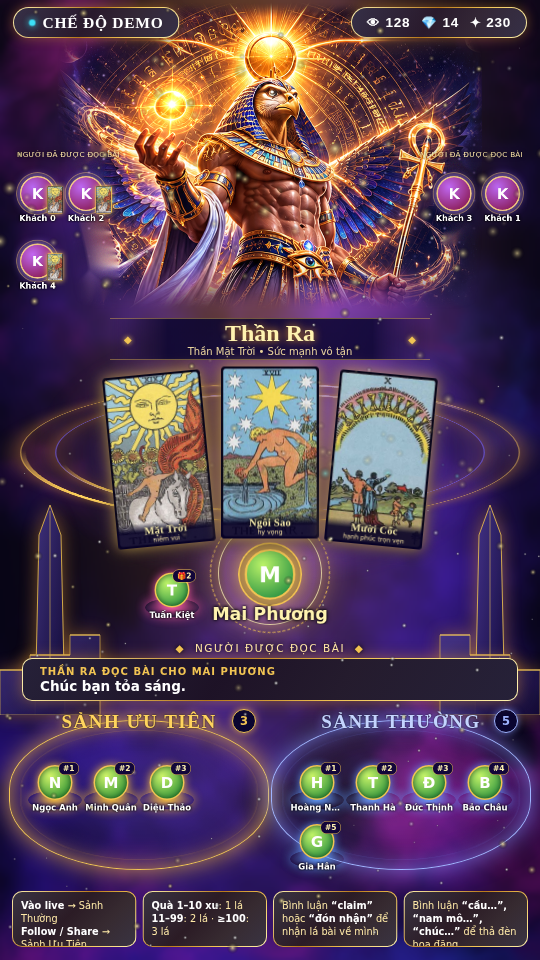

# ☀️ Cổng Vũ Trụ của Thần Ra — Tarot Live (TikTok)

Phiên live bốc bài Tarot tương tác khung dọc **9:16 (1080×1920)**. **Thần Ra** (thần Mặt Trời Ai Cập, phong cách vũ trụ hiện đại) đứng trên *Thuyền Mặt Trời*, rút bài và đọc thông điệp cho người xem theo hai hàng chờ: **Sảnh Ưu Tiên** và **Sảnh Thường**. Chạy trên **Bun.js**, giao tiếp **JSON-RPC 2.0**, giọng đọc **ZeroTTS** — cùng bộ khung với dự án "Chùa Online".



Xem trước bộ bài: `docs/deck-preview.jpg`.

## Luật tương tác (theo bảng quy tắc)

| Sự kiện TikTok | Điều kiện | Nghi thức | Ưu tiên |
|---|---|---|---|
| Tham gia phiên live | Mỗi lần vào | Bước vào **Sảnh Thường** (phải) | Mặc định |
| Follow / Share | — | Sang **Sảnh Ưu Tiên** (trái) | Mặc định |
| Thả tim | Mỗi đợt | Nhân vật chắp tay cầu nguyện, Ra sáng hơn | Mặc định |
| Quà nhỏ | 1–10 xu | Bước lên giữa sảnh, Ra rút **1 lá** và đọc nhanh | Cao |
| Quà vừa | 11–99 xu | Rút **2 lá**, đọc thông điệp kết hợp | Cao cấp |
| Quà lớn | ≥ 100 xu | Rút **3 lá** (quá khứ – hiện tại – gần tương lai) | Siêu cao cấp |
| Bình luận claim | `claim`, `đón nhận`, `xin đón nhận`, `nhận bài` | Lá bài vừa mở **bay đến người đó** | Mặc định |
| Bình luận cầu nguyện | `cầu…`, `nguyện…`, `nam mô`, `a di đà phật`, `bình an`, `chúc…`, `xin…` | Đảnh lễ + thả **Đèn Hoa Đăng**, Ra đọc lời cầu | Mặc định |

**Thứ tự đọc** (`server.js → pickNext`): người tặng quà trước (lớn > vừa > nhỏ, cùng mức thì ai đến trước); hết quà mới đến hàng chờ, theo nhịp **2 lượt Sảnh Ưu Tiên : 1 lượt Sảnh Thường** (nếu một sảnh trống thì sảnh kia được đọc liên tục). Quà cộng dồn trong lúc chờ (vd. nhiều Hoa hồng liên tiếp có thể nâng lên mức 2 lá). Người đã đọc xong **đứng cạnh chân thần Ra** (trái/phải, 3 chỗ mỗi bên); nếu đã claim thì hiện lá bài nhỏ bên cạnh. Sau `repeatAfterMin` phút (mặc định 20) họ được vào sảnh đọc miễn phí lần nữa; tặng quà thì luôn được đọc.

## Chạy nhanh

```bash
node tools/build-cards-json.mjs   # (đã sinh sẵn) tạo lại data/cards.json từ deck-data.mjs
bun install
# Giọng đọc ZeroTTS (tuỳ chọn):
#   macOS/Linux:  uv venv .venv && uv pip install --python .venv/bin/python zerotts pillow
#   Windows:      uv venv .venv ; uv pip install --python .venv\Scripts\python.exe zerotts pillow
TIKTOK_USER=ten_kenh bun start     # bỏ TIKTOK_USER nếu muốn kết nối sau trong /admin
```

- Màn hình Live: `http://localhost:3000` · OBS Browser Source 1080×1920: `http://localhost:3000/?obs=1`
- Admin (kết nối TikTok, giả lập sự kiện, xem thử lời đọc): `http://localhost:3000/admin`
- Bấm **"Tự động demo"** để thử ngay không cần phòng live thật.
- Không có ZeroTTS thì giao diện tự dùng Web Speech `vi-VN`, hoặc tắt giọng đọc trong Admin.

## JSON-RPC 2.0 (`POST /rpc` hoặc `ws://localhost:3000/ws`)

`tarot.getState` · `tarot.getDeck` · `tarot.join` · `tarot.follow` · `tarot.share` · `tarot.like` · `tarot.gift {user,coins,giftName}` · `tarot.claim` · `tarot.pray {user,wish}` · `tarot.comment {user,text}` · `tarot.preview {cards}` · `tarot.skip` · `tarot.reset` · `tarot.updateSettings` · `tarot.speak` · `live.connect` · `live.disconnect` · `live.setAutoSim`

```bash
curl -X POST localhost:3000/rpc -H 'Content-Type: application/json' \
 -d '{"jsonrpc":"2.0","id":1,"method":"tarot.gift","params":{"user":"Minh Tâm","coins":120,"giftName":"Galaxy"}}'
```

Server đẩy thông báo cho màn hình: `tarot.state`, `reading.start`, `reading.end`, `card.claim`, `lantern.release`, `person.pray`, `gift.in`, `prayer.speak`, `event.log`.

## Bộ bài & hình ảnh

- **78 lá Rider–Waite–Smith** (22 Đại Bí Mật + 56 Tiểu Bí Mật) và **mặt sau cosmic** do bạn cung cấp nằm ở `public/cards/` (`major-00.jpg` … `major-21.jpg`, `wands-01.jpg` … `pentacles-14.jpg`, `back.jpg`). Tên tiếng Việt, từ khóa và thông điệp từng lá ở `tools/deck-data.mjs` → chạy `node tools/build-cards-json.mjs` để sinh `data/cards.json`.
- Muốn đổi bộ bài/mặt sau/hình Ra: `python3 tools/import_assets.py --cards <thư mục JPG> --back <mặt sau.png> --mock <ảnh giao diện mẫu.png>` (cần `pillow numpy opencv-python`). Bộ ảnh cần đặt tên `00-TheFool.jpg … 21-TheWorld.jpg`, `Wands01.jpg … Pentacles14.jpg`.
- **Thần Ra** được cắt từ ảnh giao diện mẫu (`public/assets/ra.png`, đã xoá chữ/avatar bằng inpaint và làm mờ viền). Ra chuyển động bằng shader WebGL (`public/js/ra.js`): cánh vỗ, thở, vạt áo bay, quyền trượng đung đưa, quả cầu và đĩa mặt trời nhấp nháy, tia nắng quay; khi rút bài Ra "vung tay", quả cầu bừng sáng và bắn tia sáng xuống bộ bài. Không có WebGL thì tự dùng ảnh tĩnh nhấp nhô.
- **Hiệu ứng bài** (`public/js/live.js`): bộ bài hiện ra và xào kiểu riffle → từng lá bay theo đường cong từ bộ bài ra vị trí kèm vệt sao → dừng nạp năng lượng → **lật 3D** có sóng sáng, ánh quét và nhãn tên tiếng Việt. Claim: lá bài bay về avatar người nhận.
- Nền tinh vân động bằng shader (`public/js/bg.js`), hạt sao/bụi vàng (`fx.js`), nhạc nền + tiếng xào/lật/lấp lánh (`audio.js`).

## Cấu trúc

```
server.js            Bun/Express + WebSocket JSON-RPC, hàng chờ 2 sảnh, đọc bài, TikTok connector
tts_worker.py        ZeroTTS thường trú (giọng maichi)
tools/               deck-data.mjs, build-cards-json.mjs, import_assets.py
data/cards.json      78 lá + thông điệp · public/cards/*.jpg · public/assets/ra.png
public/              index.html, admin.html, css/live.css, js/{live,ra,bg,fx,audio}.js
```

## Lưu ý

- Nội dung Tarot mang tính **giải trí & chiêm nghiệm**, không thay thế tư vấn y tế, pháp lý, tài chính; lời đọc được viết theo hướng tích cực, không đưa ra phán đoán tiêu cực chắc chắn.
- Đọc bài chỉ dùng **bài xuôi**. Có thể mở rộng bài ngược bằng cách thêm trường `reversed` trong `composeReading`.
- Thư viện `tiktok-live-connector` là bên thứ ba không chính thức; hãy kiểm tra điều khoản TikTok và quy định về quà tặng/quảng bá của kênh bạn. Giọng đọc `maichi` là giọng nữ; nếu muốn giọng "thần" trầm hơn, đổi voice trong `settings.ttsVoice` khi ZeroTTS có thêm giọng.
- Phần kết nối TikTok, ZeroTTS và âm thanh trình duyệt **chưa được chạy thử trong môi trường dựng** (không có mạng); logic hàng chờ và giao diện đã được kiểm thử với bản giả lập.
